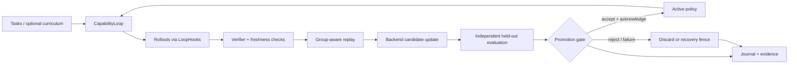

# VARE

**VARE is a CPU-first control plane for auditable post-training experiments.** It coordinates rollout evidence, policy/verifier freshness, candidate updates, independent evaluation, promotion, and recovery. Model execution and optimizer internals are supplied through hooks; [Recursive-Verification-Lag (RVL)](https://github.com/mitukx/Recursive-Verification-Lag) is an integration backend, not a bundled distributed trainer.

**Evidence boundary:** No retained real-model policy update demonstrates an independently confirmed improvement in held-out task success. Passing control-plane tests, increasing training reward, an initial model-feasibility gate, and successfully saving an optimizer update do **not** establish such an improvement.

## Problem

Long-running post-training experiments can silently invalidate their own conclusions: rollouts become stale relative to a changing policy or verifier; group-relative rewards lose their group identity; evaluations continue after a candidate is discarded; or a crash leaves an ambiguous active checkpoint. A higher proxy reward is not evidence of a better policy. VARE makes these boundaries explicit so experiments can reject unsound updates and preserve auditable failures rather than treating execution success as research success.

## Control-plane contracts

| Boundary | Implemented mechanism | Inspect |
| --- | --- | --- |
| Experiment control | `CapabilityLoop` orchestrates bounded rollouts, verification, replay, candidate training, evaluation, and decisions via `LoopHooks`. | [Engine](src/vare/engine.py), [hook contract](src/vare/interfaces.py) |
| Training-signal integrity | Policy/verifier version checks, current-freshness rescreening, group-complete replay, and a direct RVL trainer freshness guard. | [Lag](src/vare/lag.py), [replay](src/vare/replay.py), [direct-trainer report](docs/rvl-direct-trainer-freshness-v1-report.md) |
| Evaluation and promotion | Independent held-out reports, optional paired confidence and attested trajectory constraints, candidate discard, and checkpoint-bound publication. | [Gate](src/vare/promotion.py), [attestation](src/vare/attestation.py), [integration evidence](docs/rvl-evaluation-promotion-e2e-v1-report.md) |
| Ownership and recovery | Full-round same-runtime coordination and a single-host SQLite promotion journal; separate durable evaluation jobs use leases and generation fencing. | [Runtime](src/vare/runtime.py), [journal](src/vare/promotion_journal.py), [evaluation recovery](docs/recovery.md) |
| Long-horizon execution | Incremental durable agent steps, bounded execute/verify queues, worker fencing, complete-group authenticated terminal admission. | [Runtime and measured limits](docs/async-trajectory-runtime.md) |
| Reproducible experiments | Versioned protocols, bounded graders, hash-linked records, failure-oriented CPU reproductions, and retained negative outcomes. | [Runner](src/vare/runner.py), [protocols](protocols/), [evidence ledger](docs/evidence.md) |

These are distinct contracts, not a claim that every component forms one deployed, fully autonomous training system. Repository-editing agents and task catalogs are available as [experimental environment integrations](docs/environment_factory.md); large-model training/serving remains external.

## Measured end-to-end system benchmark

The [durable trajectory CPU comparison](docs/async-trajectory-runtime.md#measured-cpu-result) completed 10,000 synthetic multi-step trajectories per case across three seeds and two scheduling modes, with actual worker SIGKILL and zero duplicated effective commits. Continuous async measured 54.53 ± 1.85 trajectories/s versus 36.16 ± 2.68 for matched synchronous cohorts, with substantially longer queue latency. This measures a single-host control plane; its consumer acknowledges eligibility and performs no optimizer update.

The [multi-completion GRPO CPU validation](docs/grpo-e2e-cpu-report.md) executes 12 rounds × 3 seeds through the existing RVL trainer on a pinned small pretrained model. It verifies real optimizer updates against an independent numerical reference and fixes policy/response provenance and stale-group admission defects. Its synthetic diagnostic evaluation and unmerged RVL dependency patch are explicit; it establishes no task-capability gain.

The [actual-model CPU benchmark](docs/e2e-rl-real-model-v1-report.md) runs **rollout → verification → freshness check → replay → actual AdamW update → independent checkpoint evaluation → promotion/rejection → checkpoint recovery**. It uses a pinned public tiny GPT-2 checkpoint (102,714 parameters; 2,200 trainable) and fresh synthetic one-token tasks on Apple M1 Pro / 32 GiB. The campaign completed 78/78 declared case oracles, including 63 actual optimizer steps; an offline audit verified 1,025 artifacts and replayed checkpoint evaluation scores.

End-to-end tasks/s, mean ± sample SD over three seeds:

| Rollout workers | Minimal controls | Guarded controls |
| ---: | ---: | ---: |
| 1 | 128.97 ± 5.78 | 123.72 ± 2.57 |
| 2 | 147.45 ± 2.07 | 125.28 ± 0.47 |
| 4 | 145.17 ± 0.75 | 134.01 ± 0.19 |
| 8 | 144.82 ± 0.79 | 133.95 ± 4.73 |

Both modes use the same engine, tasks, evaluation budget and numerical updates. The comparison measures the cost of optional reward authentication, strict freshness, checkpoint-bound evaluation and durable promotion. Timing includes decision and fresh checkpoint recovery; setup and warmup are excluded. Each rollout generates one constrained token, so output tokens/s equals tasks/s.

Guarded mean wall overhead was **4.13–17.68%**; peak 20 ms sampled process-tree RSS was **3,602.52 MiB**. Guarded mode blocked all 15 injected invalid-data/evidence cases that the minimal arm admitted. Mean guarded recovery was 2.042 s after worker loss, 0.118 s after evaluation cancellation and 0.095 s after publisher loss; the report defines each timing boundary.

This is **single-round systems validation on a toy neural model and synthetic workload**. Greedy task success did not improve. Long-running worker weight synchronization, the next optimizer step after recovery, production LLM throughput and GPU/distributed scaling were not measured. The [earlier four-parameter simulation](docs/e2e-rl-system-benchmark-v1.md) is separate evidence with a different workload and baseline; see its [review corrections](docs/e2e-rl-system-benchmark-v1-errata.md).

Inspect the [report and stage latencies](docs/e2e-rl-real-model-v1-report.md), [protocol](benchmarks/e2e_rl_real_model_v1/protocol.json), [comparison CSV](results/e2e-rl-real-model-v1/comparison.csv), [raw checkpoint/telemetry archive](results/e2e-rl-real-model-v1/m1-cpu.tar.xz), and [CPU regression workflow](.github/workflows/e2e-system-cpu.yml).

The [matched synthetic verifier-refresh controls](docs/verifier-refresh-controls.md) expose a negative result: task-family TV-triggered refresh misses within-family proxy exploitation. Independent verifier error and counterfactual proxy-only promotion decisions are retained across three seeds; no model is trained in this experiment.

## Quick start

From the repository root, use an activated **Python 3.11+ virtual environment**:

```bash
python -m pip install -e '.[dev]'
python -m vare --help
python -m pytest --ignore=tests/test_math500_grader_v1.py --ignore=tests/test_math500_grader_v2.py
PYTHONPATH=src python scripts/check_tracked_blob_budget.py
python scripts/reproduce_runtime_round_ownership_v1.py --output /tmp/vare-round-review-new
```

Use a **new** output directory. The last command needs Git access to its pinned baseline; it replays CPU correctness cases, **not model learning**. The two excluded mathematical grader tests require a [separate optional lock](requirements/math500-grader-test.lock.txt). Other model, platform-specific, and accelerator reproductions have separate requirements. See the [script index](scripts/README.md), [CLI contracts](docs/execution.md), and [recovery procedure](docs/runtime-round-ownership-v1.md#operator-recovery).

### Audit the retained model benchmark

This verifies the saved bytes, metrics and fault outcomes without downloading a model or starting training:

```bash
mkdir /tmp/vare-retained-new
tar -xJf results/e2e-rl-real-model-v1/m1-cpu.tar.xz -C /tmp/vare-retained-new
python scripts/audit_e2e_rl_real_model.py /tmp/vare-retained-new/m1-cpu
```

To also replay checkpoint scores, supply the pinned model snapshot with `--model-dir`; see the [model setup and audit instructions](docs/e2e-rl-real-model-v1-report.md#research-boundary-and-reproduction).

### Run a new model benchmark

Use the isolated Python 3.11 environment and locked optional dependencies in the [reproduction instructions](docs/e2e-rl-real-model-v1-report.md#research-boundary-and-reproduction), then run:

```bash
export OMP_NUM_THREADS=1 MKL_NUM_THREADS=1 TOKENIZERS_PARALLELISM=false PYTHONHASHSEED=0
python scripts/benchmark_e2e_rl_real_model.py --output /tmp/vare-real-e2e-new
python scripts/audit_e2e_rl_real_model.py /tmp/vare-real-e2e-new
```

The runner checks the pinned model-file hashes and refuses to overwrite existing output. The [synthetic comparison](docs/e2e-rl-system-benchmark-v1.md#reproduction) uses the separate `benchmarks.e2e_rl_system.runner` entry point and needs no model dependencies.

## Architecture



The diagram describes the **control-loop contract**, not measured end-to-end autonomous improvement. RVL hooks can supply the model/GRPO backend; the standalone [bounded evaluation runner](docs/execution.md) and [durable worker store](docs/recovery.md) are separate execution paths, not implicit stages of this loop. See [architecture and component ownership](docs/architecture.md) and [engineering deep dive](docs/engineering-depth.md).

## Other retained evidence

These additional observations have their own workloads and evidence boundaries. Follow each report for protocol versions, comparison controls, raw artifacts, and restrictions.

| Evidence class | Observation | Interpretation |
| --- | --- | --- |
| CPU runtime correctness | [Whole-round ownership](docs/runtime-round-ownership-v1.md): 8/8 targeted fault cases failed on pinned main; the correction passed all 10 cases, including two controls. | Single-host cooperative hooks and SQLite reservations; no distributed atomicity. |
| CPU checkpoint IO | [Bounded reads](docs/checkpoint-read-bounds-v1-report.md): 7 pinned-main fault failures; 15 corrected IO/recovery cases passed. Five 32 MiB replacement-read pairs reduced peak traced allocation from 67,114,578 to 4,398 bytes before rejection. | Input bounds and resource-failure handling in tested fixtures; not training speed. |
| CPU evaluation lifetime | [Evaluation cleanup](docs/engine-evaluation-lifecycle-v1-report.md): 12/13 baseline regressions failed; 13/13 corrected cases passed. | Evaluator tasks terminate before candidate discard under tested cancellation schedules. |
| Real-model feasibility, not improvement | [Exact-integer base gates](docs/heldout-exact-integer-base-gate-v2.md): Qwen2.5-3B-Instruct 4-bit scored 29/64 strict pass@4; the [one-update smoke](docs/heldout-exact-integer-update-cost-smoke-v1.md) demonstrated save/reload and update cost, not a held-out gain. | A model can enter an experiment without proving an update works. |
| Negative model comparison | [OpenBookQA](docs/openbookqa-qwen25-grpo-sft-confirmation-v1-report.md): Qwen2.5-0.5B base 45.31%, matched SFT 33.33%, GRPO 0/128 on each of three seeds under the frozen parser. | This specific pairing failed; no general verdict about GRPO. |
| Retrospective record audit | [Format versus correctness](docs/format-comparison-record-v1-report.md): correctness-RL minus format-SFT +0.46875 points, 95% interval [-0.078125, +1.015625]. | Interval includes zero; original execution provenance is incomplete. No new model run. |
| Synthetic control-loop benchmark | [Four-parameter policy report](docs/e2e-rl-system-benchmark-v1.md): VARE measured 182 versus 300 rollouts/s (−39.2%) across 12 paired seeds; it rejected stale updates and fenced interrupted publication. | Control-plane fixture with a separate baseline; interrupted publication required external reconciliation. No neural-model update. |

Full model-study decisions and failed runs remain in the [experiment index](docs/experiments.md). The [evidence ledger](docs/evidence.md) preserves finer-grained controls and raw pointers; summaries are not substitutes for their original records.

## Repository structure and navigation

| Start with | Continue to |
| --- | --- |
| [Architecture](docs/architecture.md) | Ownership, control flow, optional integrations, and failure boundaries |
| [Actual-model system benchmark](docs/e2e-rl-real-model-v1-report.md) | Matched comparisons, latency/resource measurements, fault recovery, raw artifacts and reproduction |
| [Engineering deep dive](docs/engineering-depth.md) | Design decisions, tests, reproduced faults, correctness and performance tradeoffs |
| [Experiments](docs/experiments.md) and [evidence](docs/evidence.md) | Model outcomes, historical studies, negative results, protocol locks, and raw records |
| [Limitations / next admission gate](docs/current-gaps.md) | Unresolved research and engineering gaps; [qualification record](docs/research-candidate-qualification-2026-10-15.md) |
| [Documentation index](docs/README.md) and [layout](docs/repository-layout.md) | Curated entry points to `src/vare/`, `tests/`, `scripts/`, `protocols/`, and `results/` |

## Limitations

- No independent held-out task-success gain after a retained real-model update; no validated recursive improvement or autonomous research-capability gain.
- CPU/single-host fixture results do not prove distributed/GPU behavior, operational incident frequency, or throughput improvements.
- SQLite journals and hashes support recovery/consistency **only within trusted ownership and correctly verified external state**. They do not make checkpoint publication atomic with an optimizer or provide a hostile-code sandbox.
- Agent workspaces, subprocess execution, and trajectory records require separate isolation and trust roots for adversarial inputs. Optional lifecycle hooks do not constitute a deployed self-improving fleet.
- Existing observed protocols, consumed confirmation cohorts, and negative results remain frozen. New studies require novel hypotheses, independent task/model qualification, matched controls, and untouched confirmation data.

See [current gaps](docs/current-gaps.md), [trajectory safety scope](docs/trajectory-aware-safety-v1.md), and [artifact retention](docs/artifact-retention.md). The 235 previously tracked blobs at least 1 MiB remain frozen; new large artifacts belong outside Git with manifest hashes. [Apache-2.0 license](LICENSE).
