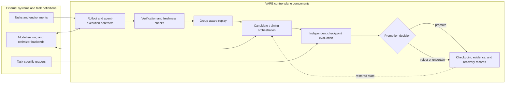

# VARE
### Auditable Asynchronous RL & Agent Evaluation Infrastructure

VARE is a CPU-first research control plane for reliable post-training and long-horizon agent experiments. It coordinates rollout evidence, freshness checks, group-aware replay, candidate evaluation, promotion decisions, and recovery through explicit interfaces.

Its engineering focus is keeping asynchronous work trustworthy: detecting stale policy or verifier information, preserving training-signal and replay integrity, binding evaluation to a candidate checkpoint, recovering from worker or learner interruption, and retaining auditable agent trajectories. Model serving, optimizer implementations, and task-specific evaluators are supplied through external backends and hooks.

VARE provides distinct control-plane components and experimental integrations. The repository does not establish that every path operates together as one deployed system, or that a model update improves independent task performance.

## Key results

| Result | Workload and comparison | Limit and evidence |
| --- | --- | --- |
| **Installed repair leakage reproduced and isolated** | On a real MLX-LM GPTQ module, installed-source and compiled-code delegation each passed 4/4 oracle cases without implementing a repair. The final image rejects both routes while preserving exact-fix acceptance. | Narrow verifier-integrity evidence. A cached 7B teacher trial produced 0/4 repairs on two Development modules; learning remains NO-GO. [Report and retained evidence](docs/flagship-verified-agent-v1-report.md) |
| **504 logical rounds; 513 actual candidate optimizer attempts; 18/18 learner SIGKILL recoveries matched uninterrupted state and subsequent updates.** | Continuous CPU control-loop benchmark on Apple M1 Pro / 32 GiB, with a pinned 102,714-parameter GPT-2 checkpoint and fresh synthetic one-token tasks. Guarded throughput was 145.57–176.49 tasks/s across three seeds and 2–8 rollout workers. | Toy-model systems validation, not capability or production inference throughput. Nine uncommitted optimizer computations were repeated after interruption; none of the committed updates was applied twice. [Report](docs/e2e-rl-continuation-v2-report.md) · [protocol](benchmarks/e2e_rl_continuation_v2/protocol.json) |
| **54.53 ± 1.85 vs 36.16 ± 2.68 trajectories/s** | Durable asynchronous execution versus matched synchronous cohorts; 10,000 synthetic multi-step trajectories per case, three seeds, single-host CPU, actual worker SIGKILL. | Async raised throughput but increased queue-inclusive p95 latency to 44.04–46.45 s from 0.240–0.290 s. The consumer acknowledged eligibility; no optimizer update or model inference was measured. [Report and raw evidence](docs/async-trajectory-runtime.md#measured-cpu-result) · [protocol](benchmarks/trajectory_runtime_v2/protocol.json) |
| **36 real GRPO candidate updates numerically replayed** | Three CPU seeds on TinyStories-1M; the independent reference compared loss, pre-clip/clipped gradients, Adam state, and parameters. | Synthetic rewards and diagnostic evaluation; an integration patch to the external trainer was applied for the experiment. This verifies update arithmetic and rollback controls, not task success or capability gain. [Report](docs/grpo-e2e-cpu-report.md) · [protocol](benchmarks/grpo_e2e_cpu_v5/protocol.json) |
| **Coding-agent rollouts and a real adapter update are measured** | Qwen3 4B passed 1/2 tasks and Qwen2.5-Coder 7B passed 0/2 in a small MLX/Metal exploratory cohort. A Qwen2.5 0.5B LoRA adapter was updated for ten optimizer steps and reloaded. | Feasibility evidence only: the rollout cohort is too small and consumed, and no held-out success comparison after update exists. The audited inventory has at most 14 unique tasks against a 15-task gate; the frozen prior-use record classifies zero eligible tasks; 15 are required. [NO-GO report](docs/mlsys-actual-model-update-no-go-v1-report.md) · [Apple Silicon measurements](docs/apple-silicon-accelerated-agent-update-v1.md) · [Agent evaluation guide](docs/agent-evaluation.md) |
| **Apple Silicon feasibility: MLX Metal 55.67 vs CPU 55.79 tokens/s; 10-step 0.5B LoRA adapter saved/reloaded; tool recovery 12/12 verified.** | Qwen3 4B short greedy microbenchmark; Qwen2.5 0.5B one-development-example LoRA smoke; six basic/VARE recovery conditions with worker SIGKILL after public-test success. | Metal showed no throughput gain in this short run. The adapter smoke is not held-out improvement; VARE reduced tool repeats but took longer due lease expiry. Three-arm coding comparison and post-training capability remain NO-GO. [Report and limits](docs/apple-silicon-accelerated-agent-update-v1.md) |

These results describe different workloads and evidence levels. They are not evidence of held-out model improvement. For protocols, baselines, reproduction commands, and further limitations, see the [benchmark guide](docs/benchmarks.md).

**Next independently verifiable milestone:** [Coding RL readiness, integration blockers and preregistered E2E study plan](docs/coding-rl-readiness-and-e2e-plan.md). This is a forward-looking proposal and does not represent an executed model-learning experiment.

## Architecture

The diagram shows the implemented control-plane contract and its external dependencies. It is not one measured end-to-end deployment: durable trajectory workers, model-training hooks, and historical agent evaluation are separate paths.



`CapabilityLoop` and `LoopHooks` define the training-control interface. Model execution and optimizer state remain the hook/backend's responsibility; the [Recursive-Verification-Lag trainer](https://github.com/mitukx/Recursive-Verification-Lag) is an optional external integration, not a bundled distributed trainer. The durable multi-step trajectory runtime, promotion journal, bounded evaluator, and coding-agent environment have separate ownership and recovery contracts. See [architecture and ownership](docs/architecture.md) and the [engineering design guide](docs/engineering-depth.md).

## Core components

Each path below links its problem, implementation, checks, retained evidence, and limits.

### Asynchronous RL and trajectory execution

- Durable multi-step trajectories, bounded execute/verify queues, leases, worker fencing, and freshness-aware admission: [runtime](src/vare/trajectory_workers.py), [store](src/vare/trajectory_store.py), [admission](src/vare/trajectory_admission.py), [tests](tests/test_trajectory_workers.py).
- Read the [trajectory benchmark](docs/async-trajectory-runtime.md) for throughput versus queue-latency tradeoffs and the boundaries of its synthetic single-host measurement.

### Training and replay integrity

- Preserve whole rollout groups and their policy/verifier provenance; recheck mutable freshness at use time: [replay](src/vare/replay.py), [lag checks](src/vare/lag.py), [RVL adapter](src/vare/integrations/rvl_grpo.py), [tests](tests/test_replay_group_freshness.py).
- Candidate optimizer and model state are supplied by hooks. The [GRPO report](docs/grpo-e2e-cpu-report.md) shows numerical reference checks and clearly separates its experimental dependency patch from merged VARE code.

### Evaluation and promotion

- Evaluate incumbent and candidate independently, bind reports to checkpoint identity, and promote, reject, or quarantine uncertain publication: [promotion gate](src/vare/promotion.py), [journal](src/vare/promotion_journal.py), [tests](tests/test_promotion_publication_recovery.py).
- Evaluation and publication cleanup must finish before candidate discard: [engine](src/vare/engine.py), [lifecycle tests](tests/test_engine_evaluation_lifecycle.py), [recovery guide](docs/recovery.md).

### Coding-agent evaluation

- Run repository tasks through bounded agent processes and evaluator-owned commands; bind workspace source and final diff to collected evidence: [environment campaign](src/vare/environments/campaign.py), [workspace verifier](scripts/verify_agent_workspace.py), [evidence collector](scripts/record_coding_agent_baseline.py), [tests](tests/test_command_agent_ownership.py).
- The [agent evaluation guide](docs/agent-evaluation.md) explains source binding, subprocess ownership, grader boundaries, and the current evidence status.

### Reproducibility and fault tolerance

- Versioned experiment protocols, retained artifacts, bounded graders, and failure-oriented checks: [protocols](protocols/), [reproduction scripts](scripts/README.md), [evidence ledger](docs/evidence.md).
- Recovery correctness is scoped to declared ownership and trusted state. At-least-once evaluation may repeat external side effects; fencing and commit identity constrain effective publication but do not reverse those effects. See [durable jobs](docs/recovery.md) and [operator recovery](docs/runtime-round-ownership-v1.md#operator-recovery).

## Engineering tradeoffs

- **Throughput and latency:** continuous asynchronous execution can complete more trajectories per second while keeping them queued much longer. Report both rates and queue-inclusive latency; the [trajectory benchmark](docs/async-trajectory-runtime.md#measured-cpu-result) shows this tradeoff on its synthetic single-host workload.
- **Freshness and utilization:** strict use-time policy/verifier checks prevent stale replay from reaching training, but rejected data can reduce usable batches and worker utilization. See [freshness admission](src/vare/lag.py) and [group replay](src/vare/replay.py).
- **Durability and synchronization:** persisting trajectory steps and promotion state improves audit and restart behavior, while database transactions, locks, and artifact checks add IO and coordination cost. The existing measurements are workload-specific; they do not quantify a universal overhead.
- **At-least-once execution and effective commit:** a worker or grader may repeat after uncertain completion. Leases and generation fencing prevent a superseded result from taking effect under the tested store contract; they cannot undo an external API call, file write, or other side effect that already happened.
- **Independent evaluation and proxy reward:** a separate held-out evaluator can detect proxy-only gains, but requires its own task budget and a trusted boundary distinct from optimization rewards. Reusing the same proxy for both roles does not establish independent task improvement.
- **Recovery and external state:** journals can record and fence declared transitions. Operators still need to verify external weights, workers, evaluator processes, and checkpoint bytes before clearing an uncertainty fence; local transactional state cannot make those systems atomic.

## Quick start

Requirements: Python 3.11 or newer. The core package has no runtime dependencies; the development extra installs pytest.

```bash
python -m venv .venv
source .venv/bin/activate
python -m pip install -e '.[dev]'
python -m vare --help
```

Run focused CPU correctness checks:

```bash
python -m pytest tests/test_lag.py tests/test_replay_group_freshness.py
```

For a minimal environment-harness example, start with the [environment smoke instructions](docs/environment_factory.md#smoke-run). It runs a synthetic harness fixture, not an agent capability benchmark. The [script index](scripts/README.md) describes other commands and their optional model, platform, or accelerator dependencies.

Run that local fixture directly from the checkout with a new output directory:

```bash
PYTHONPATH=src python -m vare.cli env-smoke --output-dir /tmp/vare-env-smoke-new
```

The smoke command checks the evaluator against its fixture baseline and oracle patch. It does not start a model, change the repository, or measure coding-agent success.

The default repository suite excludes two tests that require the optional Math-500 lock:

```bash
python -m pytest --ignore=tests/test_math500_grader_v1.py --ignore=tests/test_math500_grader_v2.py
```

For CPU model experiments, use the pinned setup and fresh output paths in the [continuous benchmark report](docs/e2e-rl-continuation-v2-report.md#evidence-and-reproduction) and [GRPO report](docs/grpo-e2e-cpu-report.md#reproduce). These download model snapshots and install optional dependencies; they are not part of the lightweight quick start. To audit retained benchmark artifacts without model downloads or training, follow the corresponding report instructions.

## Benchmarks

| Experiment | Result type | Main evidence |
| --- | --- | --- |
| Continuous CPU post-training control loop | Toy real neural model; synthetic tasks; actual optimizer and learner restart | [Report](docs/e2e-rl-continuation-v2-report.md) · [protocol](benchmarks/e2e_rl_continuation_v2/protocol.json) |
| Durable asynchronous trajectories | Synthetic single-host control-plane throughput and latency | [Report](docs/async-trajectory-runtime.md) · [protocol](benchmarks/trajectory_runtime_v2/protocol.json) |
| Multi-completion GRPO | Real optimizer arithmetic on a small pretrained model; synthetic diagnostics | [Report](docs/grpo-e2e-cpu-report.md) · [protocol](benchmarks/grpo_e2e_cpu_v5/protocol.json) |
| Actual-model fault benchmark v1 | Toy neural model; different single-round workload and baseline than continuation v2 | [Report](docs/e2e-rl-real-model-v1-report.md) · [protocol](benchmarks/e2e_rl_real_model_v1/protocol.json) |
| Verifier refresh controls | Synthetic visible/within-family shift; negative result retained | [Report](docs/verifier-refresh-controls.md) |

This table is a selected index, not a complete results summary. The [benchmark guide](docs/benchmarks.md) provides detailed workload descriptions, baselines, commands, raw-result pointers, and caveats. Historical negative and superseded records remain in the [experiment index](docs/experiments.md) and [evidence ledger](docs/evidence.md).

## Research scope and limitations

**Implemented:** orchestration contracts, freshness and provenance checks, group-aware replay, checkpoint-bound promotion decisions, durable worker/evaluation records, and repository-agent evidence tooling.

**Validated systems behavior:** selected CPU tests and retained experiments exercise bounded fault, replay-integrity, recovery, and numerical-consistency properties under their declared protocols. Passing a fixture establishes only the tested property and trust assumptions.

**Measured model outcomes:** CPU runs used small real neural models with synthetic task or reward criteria. They demonstrate optimizer execution, state recovery, or diagnostic consistency. No retained real-model policy update demonstrates an independently confirmed held-out task-success improvement.

**Unvalidated objectives:** capability improvement on independent held-out tasks, autonomous recursive capability gain, production inference throughput, GPU or distributed scaling, and production-scale reliability have not been demonstrated. Evaluation consistency does not prove task correctness; numerical replay does not constitute human independent review.

For open technical gaps and the evidence gates for future studies, see [current gaps](docs/current-gaps.md). Frozen protocols, negative results, and retained evidence should be interpreted at their stated source and measurement boundary.

## Documentation

| Reader | Start here |
| --- | --- |
| New readers | [Architecture](docs/architecture.md) · [quick start](#quick-start) |
| Systems engineers | [Engineering design and tradeoffs](docs/engineering-depth.md) · [recovery](docs/recovery.md) |
| RL researchers | [Benchmarks](docs/benchmarks.md) · [experiments](docs/experiments.md) · [evidence ledger](docs/evidence.md) |
| Agent researchers | [Agent evaluation](docs/agent-evaluation.md) · [task environment](docs/environment_factory.md) |
| Reproduction and auditing | [Reproduction index](scripts/README.md) · [artifact retention](docs/artifact-retention.md) · [documentation index](docs/README.md) |

**License:** [Apache-2.0](LICENSE).
