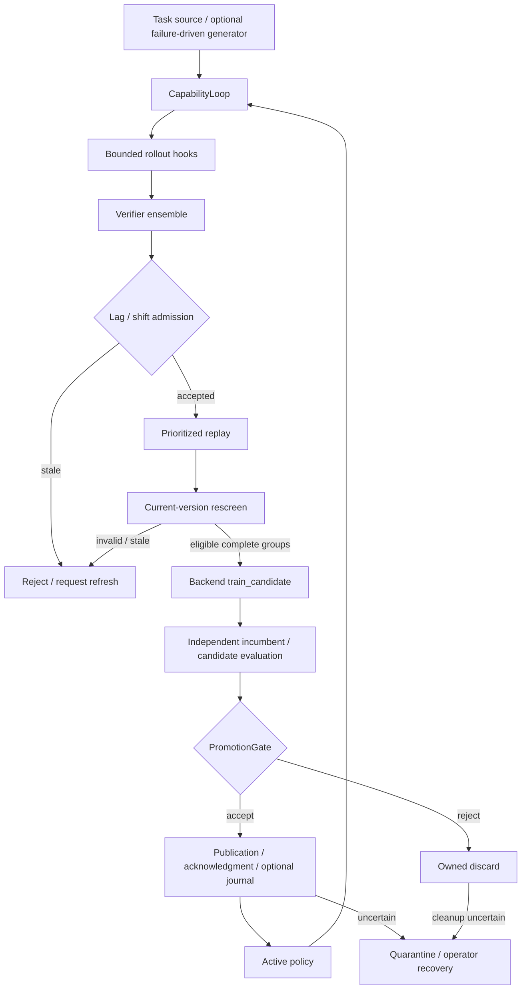

# Architecture and ownership

VARE is an **outer control plane**. The main `CapabilityLoop` owns orchestration and candidate-decision sequencing; `LoopHooks` owns model execution, optimizer state and cleanup. A successful end-to-end control-loop demonstration is not evidence that the resulting policy improves an independent task metric.

## Control flow

This is a **logical interface map**. The task generator and verifier refresh are optional [protocols](../src/vare/lifecycle.py); the system does not claim an autonomous, production rollout fleet.

## Boundaries and implementation

| Concern | Owner / implementation | Contract and limits |
| --- | --- | --- |
| Round scheduling | [`CapabilityLoop`](../src/vare/engine.py), [hook protocol](../src/vare/interfaces.py) | Bounded concurrent rollouts and ownership of evaluation/discard tasks; hooks must make their own workers terminal before returning. |
| Rollout verification | [verifier ensemble](../src/vare/verifiers.py), [lag/shift](../src/vare/lag.py) | Tracks verifier and policy version freshness; proxy verification is not independent promotion evidence. |
| Experience selection | [prioritized replay](../src/vare/replay.py) | Completeness and provenance of GRPO groups are preserved; freshness is checked again before training. |
| Model update | External `LoopHooks`; [RVL GRPO adapter](../src/vare/integrations/rvl_grpo.py) | Adapter snapshots/restores tested trainer state and guards direct trainer freshness; no independent distributed training stack is embedded. |
| Independent evaluation | [evaluation reports and gate](../src/vare/promotion.py), [trusted evaluation](../src/vare/trusted_evaluation.py) | Candidate must clear configured report/identity/slice requirements. Hashes/signatures only support claims under their stated trust roots. |
| Publication and failure | [runtime coordinator](../src/vare/runtime.py), [promotion journal](../src/vare/promotion_journal.py) | Same-event-loop ownership, optional shared local SQLite reservation, explicit acknowledgment, and stop-on-uncertainty; not distributed atomicity. |
| Engineering environment tasks | [catalog](../src/vare/environments/catalog.py), [campaign](../src/vare/environments/campaign.py) | Optional workspace-agent experiments; not an adversarial-code sandbox or implicit part of every training round. |
| Historical bounded evaluation | [runner](../src/vare/runner.py), [durable jobs](../src/vare/durable.py) | **Separate** task-grader workflow with process-group time/output bounds, local lease fencing and audit/export; not the promotion journal. |
| Optional trajectory audit | [trajectory records](../src/vare/trajectory_safety.py), [promotion constraint](../src/vare/trajectory_promotion.py) | Can reject missing/invalid attested receipts when enabled; recorder does not intercept all external I/O or contain a hostile agent. |

## Correctness invariants

1. **Keep learning and measurement separate.** The verifier producing an optimization signal is not itself sufficient promotion evidence. Refer to the [evaluation-to-promotion integration](rvl-evaluation-promotion-e2e-v1-report.md).
2. **Preserve input identity.** Group-relative training needs complete group identity and policy/verifier provenance; the RVL adapter rejects declared singleton groups. See [trajectory reference](trajectory-reference-v1.md) and [singleton regression](rvl-grpo-singleton-group-v1-report.md).
3. **Revalidate mutable state.** Freshness at admission is not freshness when the trainer acquires the model lock. See [direct-trainer check](rvl-direct-trainer-freshness-v1-report.md).
4. **Own every live task before discard.** A failed evaluation must drain its sibling before removing candidate state. See [baseline/fix replay](engine-evaluation-lifecycle-v1-report.md).
5. **Treat publication acknowledgment as fallible.** A hook may return successfully without activating the advertised policy. Unknown or partially committed state fences later work until a trusted operator verifies recovery. See [publication evidence](promotion-publication-recovery-v1.md) and [round ownership](runtime-round-ownership-v1.md).
6. **Do not rewrite negative evidence.** Frozen protocols and exact input/output manifests are retained separately from prospective experiments; see [evidence](evidence.md).

## Deployment and security non-claims

The current ownership contract assumes cooperating hooks sharing the correct coordinator or local journal, one event loop for its in-memory coordinator, and an operator-controlled checkpoint/evidence store. A database commit is not an atomic transaction over remote model weights; a stale worker may still run even if its publication is fenced. Subprocess restrictions and path checks are not a hostile-code sandbox. GPU, distributed fault tolerance, cross-host performance and independent model learning gains remain unverified. See [recovery](recovery.md), [runtime operator procedure](runtime-round-ownership-v1.md#operator-recovery), [trajectory caveats](trajectory-aware-safety-v1.md), and [current gaps](current-gaps.md).
