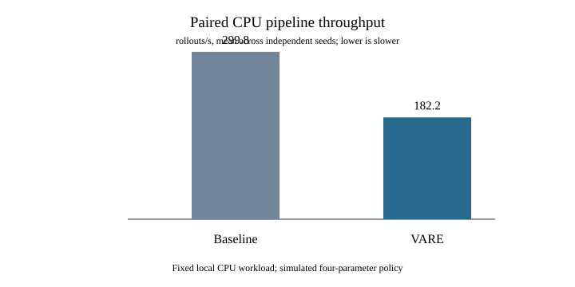

# End-to-end CPU RL system benchmark v1

This benchmark executes VARE's `CapabilityLoop` through rollout, verifier, replay, candidate training, paired evaluation, and promotion or rollback. It compares that path with a deliberately narrow straight-line reference using the same seeded workload, verifier, `PrioritizedReplay`, trainer, evaluation tasks, and CPU process setup. The locked protocol is [e2e_rl_system_benchmark_v1.lock.json](../protocols/e2e_rl_system_benchmark_v1.lock.json); the runner is [benchmarks/e2e_rl_system/runner.py](../benchmarks/e2e_rl_system/runner.py), and regression coverage is in [test_e2e_rl_system_benchmark.py](../tests/test_e2e_rl_system_benchmark.py).

## What this does and does not measure

The run uses VARE's existing four-parameter contextual-bandit policy and analytic oracle. Its optimizer mutates real in-memory policy parameters, but this is a **simulated policy workload** and makes no claim about a pretrained language model, coding performance, reward-model quality, or task-success generalization. Each round gets a new held-out set of 256 generated tasks; the same set is shared by incumbent and candidate, then retired before the next round. Training and evaluation examples are disjoint by seed.

The baseline removes VARE's use-time freshness screening, fail-closed evaluation gate, candidate transaction ownership, and round serialization. It retains the same replay implementation, training hook, evaluator, and primary-gain threshold so that the comparison isolates orchestration controls more narrowly than a comparison to an unrelated system. It is not a framework baseline and does not model production serving or distributed training.

The protocol fixes twelve independent seeds, six rounds per trial, 64 rollouts per round, concurrency eight, 32 replay samples, and 256 evaluation examples per round. Arms run in isolated child processes with alternating order. The output records raw trial rows, task-sequence hashes, per-arm timing, per-round p50/p95, isolated peak RSS, Python allocation peak, policy/verifier staleness, and bootstrap intervals over seed-level throughput. A residual stage estimate is named `orchestration_replay_residual_seconds`; it includes event handling, replay bookkeeping, freshness checks, promotion evidence calculation, scheduling and other uninstrumented orchestration. It must not be interpreted as a pure CPU profile of `CapabilityLoop`.

The three-seed fault matrix injects an actual child-process exit, stale policy and verifier evidence, evaluator failure, overlapping rounds with a candidate-ID race in the reference path, and cancellation after promotion mutates the live policy but before acknowledgment. The last case is intentionally not called a rollback: without durable independent reconciliation, VARE fences the runtime, and the state remains unresolved. For evaluator and promotion fault cases, the harness installs a known positive synthetic candidate to ensure the targeted boundary is reached; those cases measure fault handling, not training.

## Reproduction

Use Python 3.11+ and the repository's normal development installation. From the repository root, choose a new output directory:

```bash
python -m pip install -e '.[dev]'
PYTEST_DISABLE_PLUGIN_AUTOLOAD=1 python -m pytest tests/test_e2e_rl_system_benchmark.py -q
python -m benchmarks.e2e_rl_system.runner --output results/e2e-rl-system-benchmark-v1/run-1
```

The test command disables unrelated globally installed pytest plugins because one local plugin combination has an incompatible ANTLR runtime. The benchmark itself has no third-party runtime dependency. The runner refuses to overwrite an existing result directory. It writes `trials.jsonl`, `faults.jsonl`, `summary.json`, `summary.csv`, three SVG plots, and SHA-256 digests. Preserve failed runs and use a new `run-N` path for each reproduction.

For a quick smoke before the full protocol, use at least two seeds and rounds. That reduced run is a code-path check only and must not be substituted for the locked result.

## Results

The retained run used the locked 12 seeds on an Apple M1 Pro with 10 logical CPUs and 32 GiB RAM, macOS 27.0.1, and Python 3.12.12. Each arm completed 72 rounds and 4,608 rollouts. The 24 performance trials ran in separate processes with alternating arm order. Rollout task-sequence hashes matched for all 12 seed pairs; all 72 paired round-evaluation task-set hashes matched, and each round used a distinct held-out cohort.

| Metric | Straight-line baseline | VARE | Paired VARE − baseline, 95% bootstrap interval |
| --- | ---: | ---: | ---: |
| Throughput (rollouts/s) | 299.76 | 182.22 | −117.54 [−120.09, −114.48] |
| Round latency p50 (s) | 0.221 | 0.349 | +0.138 [+0.134, +0.141] |
| Round latency p95 (s) | 0.373 | 0.512 | +0.139 [+0.133, +0.146] |
| Peak RSS median (MiB) | 31.33 | 32.04 | +0.53 [+0.24, +0.82] |
| Python allocation peak median (MiB) | 1.58 | 1.72 | — |
| Uninstrumented orchestration/replay residual per round (s) | 0.209 | 0.347 | +0.138 [+0.135, +0.140] |
| Evaluator time per round (s) | 0.00322 | 0.00326 | — |

The measured VARE arm was **39.2% lower in throughput** than this reference on this fixture. This is a negative systems result, not a speedup claim. The VARE residual includes promotion evidence checks and paired bootstrap diagnostics (500 resamples in this protocol even though the confidence gate is disabled), freshness/replay work, event handling, and other uninstrumented Python overhead. It is a useful end-to-end residual, not a profiler attribution. The gate and residual were measured with 500 bootstrap draws, below the default 2,000-draw setting, so the recorded overhead should not be treated as a worst-case setting.

Rollout policy/verifier lag was zero in both arms. Across selected replay batches, the baseline reached policy lag 3 and consumed 19 samples beyond the configured maximum lag 2 across the 12 runs; three training updates included at least one such sample. VARE's consumed replay lag max was 2 and it accepted zero out-of-bound training samples. Verifier lag remained zero. This contrasts freshness behavior, not downstream policy quality.

The 30 fault rows (five cases × three seeds × two arms) showed:

| Injection | Baseline | VARE |
| --- | --- | --- |
| Worker subprocess exits during rollout | Exact policy snapshot retained and retry completed in 3/3; mean retry 9.53 ms | Exact policy snapshot retained and retry completed in 3/3; mean retry 29.39 ms |
| Policy lag 3 and verifier lag 4 | No stale rows dropped; 32 stale rows reached training in each repeat, with an update accepted in 3/3 and point-gain promotion in 2/3 | All 64 stale rollouts dropped in 3/3; no training update or promotion |
| Candidate evaluator raises | Candidate snapshot leaked in 3/3; a later retry completed | Candidate discarded and incumbent state restored in 3/3; a later retry completed |
| Two overlapping rounds | Duplicate candidate ID in 3/3; shared state version advanced twice | Both rounds completed without a duplicate candidate ID in 3/3; serial ordering yielded one promotion |
| Cancellation after live promotion mutation | Candidate remained active; no re-entry fence | Candidate remained active, but re-entry was blocked with `PromotionRecoveryRequired` in 3/3 |

Mean failure-handling time was 12.54 ms for VARE and 12.52 ms for the baseline in the worker-exit case. For evaluator failure it was 8.14 ms and 7.42 ms. The subsequent VARE retry was slower in both cases because it runs the complete guarded path. Timing comes from only three synthetic fault repetitions, so it is descriptive. The interrupted-promotion case is a material limitation: VARE prevents unverified re-entry but does **not** restore the incumbent in this no-journal fixture; exact rollback was 0/3 in both arms. Durable external reconciliation remains required.

The worker-exit injection launches a real child that calls `os._exit(73)` inside the rollout hook; the hook converts the exit status to an exception. This validates the loop's response to a failed hook and subsequent retry, but it is not a test of a production process-pool supervisor. Evaluator and promotion faults use a known positive synthetic candidate to make the targeted boundary reachable; these are control tests, not trained results.

### Retained evidence

- [Raw isolated performance trials](../results/e2e-rl-system-benchmark-v1/run-1/trials.jsonl) and [raw fault rows](../results/e2e-rl-system-benchmark-v1/run-1/faults.jsonl)
- [Machine-readable summary](../results/e2e-rl-system-benchmark-v1/run-1/summary.json), [CSV summary](../results/e2e-rl-system-benchmark-v1/run-1/summary.csv), and [SHA-256 manifest](../results/e2e-rl-system-benchmark-v1/run-1/manifest.json)
- [Throughput plot](../results/e2e-rl-system-benchmark-v1/run-1/throughput.svg), [latency plot](../results/e2e-rl-system-benchmark-v1/run-1/latency.svg), and [memory plot](../results/e2e-rl-system-benchmark-v1/run-1/memory.svg)



The first full-suite attempt used system `python3` 3.9.6 for child commands and did not pass the checkout's `src` path into subprocesses; it reported 22 environment-related failures. The failing groups then passed 34/34 when the active Python 3.12 environment was placed first on `PATH` and the checkout `src` directory was supplied through an absolute `PYTHONPATH`. With that environment, the repository's recommended suite completed with **917 passed**; the benchmark-specific suite passed **7/7**, and Ruff plus compile checks passed.

The source revision measured was `19f67abf66c683c899ef37ab771531f24aee3db6`. The raw trial SHA-256 is `cf9d65bfa5be3dffa602971c0ed4542fb7f46f3ee10ea59a147232f374402b66`; the fault JSONL SHA-256 is `60477c72b566babecf398b58b586b8d093498a1632d49bd8ed348c74eada5320`. Same-host reruns establish reproducibility of this procedure, not independent reproduction by another operator or generalization to real-model training.
