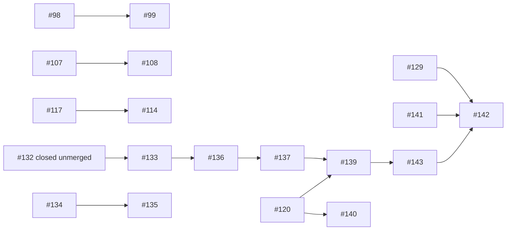

# Sprint VI: research and integration results

**Date:** 2026-10-28 (JST)
**Repository:** `mitukx/VARE`
**Research record:** `results/sprint_vi_20261028/`
**Scope:** external Development repair qualification, real-model tool trajectories, PR review debt, and protected-main integration status.

## Executive result

This sprint produced four distinct, control-qualified external Transformers Development task families and retained paired real-model trajectories for them. Each family was used only as Development evidence and is now consumed. Across the four paired cohorts, no candidate changed the target source and there were **zero independently verified repairs**. The models and controllers mostly failed before an edit or emitted edits rejected by strict source validation.

A further Qwen2.5-Coder-14B paired run on Transformers #49842 completed one arm and resource-aborted the other. That family had already been used in Sprint II; a retained invalidation record explicitly disqualified it before this run. This launch was an experimental-integrity error. The run is preserved as repeat-exposure controller diagnosis and is excluded from fresh-task counts, held-out outcomes, and training data. `results/sprint_vi_20261028/campaign_49842_musicgen_melody/append-only-prior-exposure-reconciliation-v1.json` records the prior exposure, root cause, and corrective gate.

Engineering advanced: PR #133 contains direct fixes for its two P2 navigation findings. Both new regressions fail at the previous head and pass at the updated head; 37 related tests, Ruff, and `git diff --check` pass locally. At exact head `e8ab4705b84d82cd79e2883c391083087e82b4e8`, `ci`, `cpu-evidence`, and `e2e-system-cpu` all passed. The corrected V4 campaign harness passed 95/95 continuation tests and 4/4 GRPO CPU regression tests. The harness commit is `a65d59e5704b84a934a49385551a8d2311a01575`; runtime hashes remain validated against immutable V4 runtime commit `d251cc678fbc9940f3de460904d5d23a1967b3ce`. The branch is still stacked on closed, unmerged #132, has two unresolved P2 threads, and lacks independent approval, so it is not mainline integration.

No PR was merged or closed. `main` stayed at `f3ab90a36e8724441b6b9555255f8f75a0a4d529`. PR #142 received this report, the live PR ledger, raw attempt journals, qualification receipts, and append-only reconciliations; it remains Draft pending independent review.

## Protocol and evidence boundaries

- Fresh Development tasks were selected from public upstream source-fix histories. The four accepted families below passed baseline-fail, known-fix-pass, and incorrect-mutant-fail controls with candidate isolation. Their model-pretraining exposure is **UNKNOWN**.
- A task family, not an attempt, is the unit for repair outcomes. Each accepted family used a matched autonomous/localized pair at its declared checkpoint and budget; the four families used different models or controller versions, so the cohort does not support a pooled model-effect estimate.
- Hidden grader code and hidden test source are not included in the public bundle. Model outputs, tool traces, source/protocol identities, control receipts, resource logs, and derived integrity manifests are retained.
- No reserved held-out task was used. Development exposure is recorded; these tasks cannot later count as blind held-out tasks.
- The #49842 protocol had a preregistered paired design and fixed resource caps, but the prelaunch eligibility check failed to consult the existing cross-sprint invalidation record. The resulting trajectory is excluded from the new-task primary metric.
- The #49900 historical assessment had a separate wrapper bug: a helper stripped Git stdout, erased meaningful final-newline bytes, and yielded a nonempty synthetic diff for an unchanged workspace. A false grader failure from that artifact is not a candidate result. `reconciliation_49900_append_only_v2.json` recomputes raw-byte diffs and preserves the original files unchanged.

## Qualified task families and coding-agent outcomes

| Development family | Source identity | Model / snapshot | Paired result | Independent repair |
|---|---|---|---|---|
| Transformers #49696, encoder sentinel/logits processors | Base `09a71e5b32a747dbc7805599457e67c956ef212f`; fix `ef1c61d3386d25275e4b8579ab2abf6ef4cf3c60` | `mlx-community/Qwen2.5-3B-Instruct-4bit`, `4f83f8f146fdf28b512a06562b671d7af4fab457`, MLX 0.32.4 / mlx-lm 0.32.2 | 2 attempts. A failed tool/schema generation; B accepted calls but did not read source. No edit. | 0; no candidate hidden grading |
| Transformers #49975, tensor-parallel gradient hook lifecycle | Base `6c5f8f4186c15f4bfbd67941a1736b2b347e0155`; fix `0876d33998f49c423fb8623b6bd397caf3b372fc` | Same cached 3B snapshot as #49696 | 2 model attempts (512 generated tokens each) failed at the tool/controller interface; one separate preflight attempt stopped before inference at the memory guard. | 0; no edit or candidate grading |
| Transformers #50001, token-classification lazy import | Base `6317971aa31593f77b5335e806009dc2f1e94617`; calibration `f39ea9ea753d55371b98676b107b5d39d7399d0e` | `mlx-community/Qwen2.5-Coder-7B-Instruct-4bit`, `019cc73c45c770444708a6dd8690c66243cc5c80`, MLX CPU | 2 attempts. Autonomous made 11 tool calls (6 searches, 4 reads); localized made 1 read. Neither edited or ran tests. Wall times 480.7 s / 104.7 s; swap growth 0. | 0; no candidate hidden grading |
| Transformers #49900, NumPy integer-label dtype | Base `50a952d06c8f593b5a0cea5dc8040fad9761ea67`; candidate baseline commit `80efcba045c3a7b228630caecb6fe214548506ca` | `mlx-community/Qwen2.5-Coder-14B-Instruct-4bit`, `29efdbab55a161237ab1e432a3abaf6c7ae2b477`, MLX 0.32.4 / mlx-lm 0.32.2 | 2 attempts, 541 generated tokens each. Both searched/read and emitted no source edit. A reached the argument-slot token budget; B's legacy post-processor built a false diff. A 147 s / 2.06 GiB peak RSS; B 148 s / 1.16 GiB peak RSS; both 0 swap growth. | 0. B's `FAIL` receipt is excluded because raw source was unchanged and canonical diff was empty. |

All four families passed their source/grader controls: baseline FAIL, known fix PASS, wrong mutant FAIL. #49696 also tested an output-spoof candidate: public checks alone passed, but the independent hidden grader rejected it. #49975 additionally rejected spoof and nonce-forgery controls. This establishes useful evaluator calibration, not model capability.

**Task-level outcome:** 0/4 qualified task families produced a verified repair in the paired Development cohorts. The within-task paired success difference was 0 families, but the tasks were selected rather than randomly sampled and used heterogeneous model configurations; no pooled confidence interval or generalization claim is justified. The separate #49772 reverse-capture task has two retained model attempts but its qualification record remains `qualification_pending`, so it is not counted. #49994 was rejected by its task contract. The #49842 family is excluded as prior-exposed.

## #49842 repeat-exposure 14B diagnostic (excluded from the fresh cohort)

The family had already been exercised in Sprint II: Qwen2.5-Coder-7B guidance-v1/v2 attempts generated 267/268 tokens, made no edit, and were not graded as repairs. The new Sprint VI selection duplicated that family despite the retained `invalidation-v1.json`.

The Sprint VI paired protocol froze seed 2029, temperature 0.2, top-p 0.95, top-k 20, 12 turns, up to 1,024 tokens per turn / 4,096 total, 8,192 context, and an 1,800-second attempt cap. It compared autonomous source navigation with a localized arm given a deterministic 80-line source excerpt. This is an information-value comparison because the localized arm received additional source-location information.

- **Model:** `mlx-community/Qwen2.5-Coder-14B-Instruct-4bit`, snapshot `29efdbab55a161237ab1e432a3abaf6c7ae2b477`, 4-bit, 8,321,093,967 weight bytes; MLX 0.32.4, mlx-lm 0.32.2, Python 3.12.
- **Device caveat:** commands selected `--mlx-device cpu` and the event journal says CPU, but process sampling observed Metal activity. A CPU-only run is not established.
- **Autonomous:** 12/12 model outputs were schema-valid, 846 generated tokens, 1 successful search, 5 successful reads, 4 edits rejected by Python syntax validation, and 1 public test run. That public test failed on the unchanged baseline with the expected `IndexError`. No patch was applied and hidden grading was not run. It exhausted its turn budget after 1,229.9 s; minimum free memory was 27%, monitor RSS peak 2.65 GiB, swap growth 427.37 MiB. A process sample separately showed up to 10.8 GiB physical footprint, so RSS understates memory use.
- **Localized:** 4/4 model outputs were schema-valid, 1,904 generated tokens, 2 successful reads, and 2 edit proposals rejected with `python_fence_not_exact`. The monitor stopped the process at 631.6 s when swap growth reached 653.5 MiB, exceeding the unchanged 512 MiB cap; minimum free memory was 28%, monitor RSS peak 607 MiB. No public test or candidate grading ran. No cap was raised.
- Both target files remained byte-identical to baseline `5b27dea955c5f5c64c1c16d8564a51ce38be3ac655b73db6f5c7fee100988b82`; both canonical diffs were empty. Both hidden grader results are `NOT_RUN_NO_CANDIDATE_PATCH`.

This run shows that schema-constrained JSON generation can produce valid tool actions, but strict edit normalization and model source-edit behavior still block repairs. It is not fresh-task capability evidence. Preserve it as a negative controller/resource result only.

## Engineering and PR state

The machine-readable ledger at `results/sprint_vi_20261028/pr-ledger.json` records all 18 open PRs, their exact base/head, draft state, CI snapshot, review threads, dependencies, changed-file counts, disposition, and next action. Post-snapshot head changes and the later exact-head CI/review snapshot are kept separately in `results/sprint_vi_20261028/pr-post-audit-updates-v1.json`. Classification counts are 4 `MERGE-CANDIDATE`, 3 `REPAIR-FIRST`, 2 `EXTRACT`, 4 `RESEARCH-EVIDENCE`, and 5 `BLOCKED`. No open PR was clearly proven superseded; no PR was closed simply to reduce the count.

- **PR #133:** source fixes are at `947bbb08054174f7e3c569e257f129091c8df04f`: `_bounded()` truncates auxiliary path inventory before dropping ranked results; search retries transient index-build failures and stays fail-closed. Both regressions fail on prior head `a65d59e5704b84a934a49385551a8d2311a01575`; the relevant source-navigation/tool suite passes 37 tests, Ruff, and `git diff --check`. E2E run [40544616237](https://github.com/mitukx/VARE/actions/runs/40544616237) correctly rejected running the historical V4 workload from an evolved runtime tree. The next workflow revision pinned only the immutable runtime commit `d251cc6`; E2E run [40547856230](https://github.com/mitukx/VARE/actions/runs/40547856230) then showed that this runtime-only commit predates V4 campaign-auditor admission: 60 tests failed at the pinned-inventory gate. No hash check was weakened. A following attempt at harness commit `701b5c5` passed 94/95 tests but revealed a stale V3-era expected diagnostic. The final workflow uses corrected V4 harness commit `a65d59e5704b84a934a49385551a8d2311a01575`, preserving the runtime source pin `d251cc678fbc9940f3de460904d5d23a1967b3ce`; its E2E-only timeout is 25 minutes after the prior 15-minute cap cancelled the complete suite. At exact head `e8ab4705b84d82cd79e2883c391083087e82b4e8`, CI [40554669721](https://github.com/mitukx/VARE/actions/runs/40554669721), CPU-evidence [40554669903](https://github.com/mitukx/VARE/actions/runs/40554669903), and E2E [40554669884](https://github.com/mitukx/VARE/actions/runs/40554669884) all succeeded. The V4 continuation suite reports 95 passed in 200.16 s; GRPO CPU regression reports 4 passed in 23.47 s. Two P2 threads remain unresolved; #133 is still stacked on closed, unmerged #132 and has no independent approval.
- **PR #142:** its existing evidence-archive branch carries this report, raw trajectories, qualification receipts, prior-exposure reconciliation, and append-only PR-state snapshots. The two 1.71 MB #50001 protocol JSON files are stored losslessly as deterministic gzip with original byte counts and SHA-256 digests; the verifier expands and checks them. It verifies 188 bundle files, both event chains, and prior-exposure exclusion; the tracked-blob budget passes. At final evidence head `5b06daa8ad5dc8ac8e02162d52befb92636bedb4`, exact-head PR CI [40550367521](https://github.com/mitukx/VARE/actions/runs/40550367521) and CPU-evidence [40550367254](https://github.com/mitukx/VARE/actions/runs/40550367254) succeeded. The PR remains Draft with independent review required.
- **PR #143:** focused main-based canonical candidate-diff export; exact-head checks were green, but no independent approval is recorded.
- **PR #140:** focused main-based evidence-manifest integrity change; checks were green; one outdated P2 thread remains unresolved and there is no independent approval.
- **PR #120:** the P1 completion-forgery thread remains open for independent reviewer confirmation, but the current implementation already rejects the reported import/output/early-exit spoof before candidate execution; the retained adversarial regression and 7 focused grader tests pass, and exact-head checks are green. The separate empty-manifest fix is extracted to #140. Until independent review, #120 remains outside the trusted reward path.
- **PR #139:** Draft, large stacked experimental/controller branch; exact-head CI was green at the live snapshot but it remains behind #137/#136/#133 and is not integrated.
- **PR #99:** two current P1 source-integrity findings remain. PR #117 has four outdated review findings; #136/#137 remain stacked behind #133.
- **Dependency note:** #132 was closed without merge and contains 11,403 additions on its branch. PR #133 is based on that branch. Retargeting #133 to main would import the whole dependency history, so this sprint leaves it stacked rather than disguising a bulk integration as a small fix.

### PR inventory

The full ledger below is an audit snapshot captured at `2026-10-27T16:52:43Z`; later exact-head updates are listed after the before/after table.

| PR | disposition / draft | base SHA → head SHA | exact-head checks at audit capture | unresolved threads / approval | deps | next action |
|---|---|---|---|---|---|---|
| [#99](https://github.com/mitukx/VARE/pull/99) Calibrate isolated MLX-LM 1971 Development task | REPAIR-FIRST; Draft | `f3ab90a3` → `762a5a65` | e2e-system-cpu=success; cpu-evidence=success; ci=success | 2 current / 0 outdated; REVIEW_REQUIRED | #98 | Address both P1s in a prospective version, rerun baseline/fix/mutant and adversarial controls, then request independent review. |
| [#108](https://github.com/mitukx/VARE/pull/108) Add dual-Python HF Coding Development protocol v2 | BLOCKED; Draft | `ab8d7c0b` → `710dbc0d` | ci=success; cpu-evidence=success | 0; no approval recorded | #107 | Reconcile parent and task eligibility; retain negative outcomes, then request review of a narrowly scoped protocol. |
| [#114](https://github.com/mitukx/VARE/pull/114) Preserve attested MLX-LM calibration evidence on publication failure | RESEARCH-EVIDENCE; Draft | `0d843a3e` → `8257a4df` | cpu-evidence=success; ci=success | 0; no approval recorded | #117 | Keep evidence, compare helper code with main before extraction; obtain review on the complete dependency chain. |
| [#117](https://github.com/mitukx/VARE/pull/117) Isolate MLX-LM source snapshots before trusted export | BLOCKED; Draft | `8257a4df` → `6709aed9` | ci=success; cpu-evidence=success | 0 current / 4 outdated; no approval recorded | — | Preserve calibration history; obtain independent review of each current implementation before changing Draft/base state. |
| [#118](https://github.com/mitukx/VARE/pull/118) Extract hash-checked structured edit library without changing frozen agent runtime | EXTRACT; Draft | `aef27e3b` → `552d6f61` | cpu-evidence=success; ci=success; e2e-system-cpu=success | 0; no approval recorded | — | Compare against #143 and current runner before extracting only still-used APIs to a main-based test PR. |
| [#120](https://github.com/mitukx/VARE/pull/120) Record real-model coding-agent feasibility and tool-boundary fixes | REPAIR-FIRST; Ready | `f3ab90a3` → `8aacae54` | ci=success; e2e-system-cpu=success; cpu-evidence=success | 1 current / 1 outdated; REVIEW_REQUIRED | — | Have an independent reviewer run the forged-output/early-exit regression; extract only the task-grader fix if the historical bundle is too broad. |
| [#121](https://github.com/mitukx/VARE/pull/121) Add independent source replay for Transformers fusion registration | MERGE-CANDIDATE; Ready | `f3ab90a3` → `a937f4ad` | ci=success; cpu-evidence=success | 0; REVIEW_REQUIRED | — | Review task exposure and grader artifacts, obtain independent approval, then merge if the review confirms the frozen boundary. |
| [#122](https://github.com/mitukx/VARE/pull/122) Close installed-repair leakage and record the 7B teacher NO-GO | MERGE-CANDIDATE; Ready | `f3ab90a3` → `37b31519` | cpu-evidence=success; ci=success | 0; REVIEW_REQUIRED | — | Review diff for historical evidence scope, then obtain independent approval and merge through branch protection. |
| [#126](https://github.com/mitukx/VARE/pull/126) Measure verifier-version-aware GRPO under drift and crashes | RESEARCH-EVIDENCE; Ready | `a476feee` → `c728b9f2` | e2e-system-cpu=success; cpu-evidence=success; ci=success | 0; no approval recorded | — | Preserve records; compare exact source deltas against main before extracting any still-unique integrity code. |
| [#131](https://github.com/mitukx/VARE/pull/131) Measure deterministic edit replay and recovery; pin E2E inventories | RESEARCH-EVIDENCE; Draft | `07135298` → `139de538` | cpu-evidence=success; ci=success; e2e-system-cpu=success | 0; no approval recorded | #129, #130 | Retain historical evidence; extract only source changes still needed after comparing with #143/#139. |
| [#133](https://github.com/mitukx/VARE/pull/133) Add bounded source navigation for repair agents | REPAIR-FIRST; Ready | `da4bc586` → `947bbb08` | ci=in_progress; e2e-system-cpu=in_progress; cpu-evidence=in_progress | 2 current / 0 outdated; REVIEW_REQUIRED | #132 | Wait for exact-head CI, then obtain independent reviewer confirmation of both regressions and review the stacked dependencies; do not merge through protected main without approval. |
| [#135](https://github.com/mitukx/VARE/pull/135) Add process-creation boundary preflight for 47468 v4 | BLOCKED; Draft | `d8636def` → `b258c69f` | cpu-evidence=success; ci=success | 0; no approval recorded | #134 | Reconcile the closed/missing parent, refresh task qualification, then decide whether this preflight remains needed. |
| [#136](https://github.com/mitukx/VARE/pull/136) Harden source navigation syntax checks | BLOCKED; Ready | `a65d59e5` → `eaf3fd58` | cpu-evidence=success; ci=success | 0; no approval recorded | #133 | Keep behind #133; confirm exact-head tests after parent review. |
| [#137](https://github.com/mitukx/VARE/pull/137) Fix source-navigation review findings | BLOCKED; Ready | `eaf3fd58` → `6d95bd91` | e2e-system-cpu=success; ci=success; cpu-evidence=success | 0; no approval recorded | #136 | Resolve/review #133 and integrate dependencies in order; do not retarget or merge around the chain. |
| [#139](https://github.com/mitukx/VARE/pull/139) Fix navigation regressions and measure fresh Development agent failures | EXTRACT; Draft | `6d95bd91` → `cde7e56f` | cpu-evidence=success; ci=success; e2e-system-cpu=success | 0; no approval recorded | #120, #133, #137 | Keep the negative evidence in #142; extract only independently reviewed source-navigation fixes after parent #137/#136/#133 decisions. |
| [#140](https://github.com/mitukx/VARE/pull/140) Reject empty coding-agent evidence manifests | MERGE-CANDIDATE; Ready | `f3ab90a3` → `34f972eb` | ci=success; cpu-evidence=success | 0 current / 1 outdated; REVIEW_REQUIRED | #120 | Ask an independent reviewer to confirm the symlink/archive-fallback regression; merge only after approval. |
| [#142](https://github.com/mitukx/VARE/pull/142) Publish verified external repair campaign evidence | RESEARCH-EVIDENCE; Draft | `f3ab90a3` → `be2de0a2` | ci=success; cpu-evidence=success | 0; REVIEW_REQUIRED | #129, #141, #143 | Add Sprint VI report, compact raw trajectory package, task manifests and refreshed audit ledger; retain Draft until review. |
| [#143](https://github.com/mitukx/VARE/pull/143) Export candidate diffs from pinned workspaces | MERGE-CANDIDATE; Ready | `f3ab90a3` → `6266ec0a` | cpu-evidence=success; ci=success | 0; REVIEW_REQUIRED | #139, #141 | Obtain an independent approval; merge through protected main if the reviewer confirms the current source/hash regressions. |

### Dependency graph

PR-body and stacked-branch dependencies captured by the ledger (some are evidence prerequisites rather than direct Git parents):

### Before/after GitHub counts

| Measure | Sprint start | After this sprint |
|---|---:|---:|
| Open PRs | 18 | 18 |
| Draft PRs | 9 | 9 |
| Merged PRs during sprint | 0 | 0 |
| Closed PRs during sprint | 0 | 0 |
| Updated PRs during sprint | 0 | 2 (#133, #142) |
| Independent approvals recorded | 0 across open PRs | 0 across open PRs |
| Main SHA | `f3ab90a36e8724441b6b9555255f8f75a0a4d529` | unchanged |

### Exact-head updates after the ledger snapshot

- PR #133's initial E2E failure [40544616237](https://github.com/mitukx/VARE/actions/runs/40544616237) was the evolved-runtime/source mismatch. Run [40547856230](https://github.com/mitukx/VARE/actions/runs/40547856230) then used `d251cc6` as both V4 runtime and campaign harness; 60 tests failed because that runtime-only revision predates V4 inventory admission. The `701b5c5` campaign-harness run [40553026570](https://github.com/mitukx/VARE/actions/runs/40553026570) passed 94/95 tests; one test still expected a V3-era error message. Final head `e8ab4705b84d82cd79e2883c391083087e82b4e8` runs the corrected campaign harness `a65d59e5704b84a934a49385551a8d2311a01575` with runtime source hashes still pinned to `d251cc678fbc9940f3de460904d5d23a1967b3ce`. All exact-head checks pass: CI [40554669721](https://github.com/mitukx/VARE/actions/runs/40554669721), CPU-evidence [40554669903](https://github.com/mitukx/VARE/actions/runs/40554669903), and E2E [40554669884](https://github.com/mitukx/VARE/actions/runs/40554669884); V4 continuation 95 passed in 200.16 s, GRPO CPU 4 passed in 23.47 s. Earlier head `6c350c46` was cancelled at the 15m24s mark; the E2E-only CI wall time is now 25 minutes. No model/resource/protocol budget or source-integrity check was changed.
- PR #142 publication initially failed blob-budget at head `c282a9ff9dd95ad3f73aec6224661edf6d7e82f6`; commit `5830509eeaa6795ba1bdff949e23868aa796ce42` switched the two large protocol artifacts to verified lossless gzip. At final evidence head `5b06daa8ad5dc8ac8e02162d52befb92636bedb4`, CI [40550367521](https://github.com/mitukx/VARE/actions/runs/40550367521) and CPU-evidence [40550367254](https://github.com/mitukx/VARE/actions/runs/40550367254) succeeded. The append-only PR-state snapshots are `pr-post-audit-updates-v2.json`, `pr-post-audit-updates-v3.json`, and the review-state clarification in `pr-post-audit-updates-v4.json`.
- Neither PR changed `main`; no review approval or merge requirement was bypassed.
Main is protected. The branch-protection endpoint returned 403 to the connected integration; no protection setting was changed. GitHub reports PR #133 `mergeState=CLEAN` relative to its stacked base, but its `reviewDecision` field is blank; there are still two unresolved P2 threads and no independent approval. This is not mainline integration eligibility. No independent reviewer has been identified or requested through the available metadata; no arbitrary reviewer was selected. No approval was fabricated, and no merge or forced close occurred.

## Learning, long-horizon execution, and RSI

- **SFT/GRPO:** not run. No newly verified model-generated repair exists as eligible coding-reward training data; the held-out readiness record remains 9/15, below the 15-family gate. The older Qwen2.5-0.5B adapter reload / one-token smoke remains a load check only, not an improvement result.
- **Held-out improvement:** not run. No Development task was reused as held-out, and no result is described as blind. Pretraining contamination is unknown.
- **Model-coupled long-horizon RL:** not run. The new 14B runs contain short synchronous tool traces; they do not test durable continuation, asynchronous rollouts, fault injection, recovery, optimizer commit replay, or checkpoint promotion. The repository's prior 504-round / 513-attempt / 18-of-18 synthetic recovery evidence remains synthetic systems evidence only.
- **RSI automation:** not run. There was no measured outer loop in which an agent's hypothesis selected a fresh experiment, independent measurement chose a change, and a subsequent experiment demonstrated improvement.

## Final outcome table

| Objective | Status | Sprint VI evidence / decision |
|---|---|---|
| Schema-constrained tool generation | `PARTIAL` | Runtime produced multiple consecutive schema-valid calls, including 16/16 actions in the repeat-exposure #49842 pair. No complete repair interaction; edit proposals were rejected. |
| Strong-model inference | `RUN` | Qwen2.5-Coder-14B snapshot loaded and generated; one arm completed, the other hit the fixed swap cap. Device was not proven CPU-only. |
| Fresh external Development tasks | `RUN` | Four distinct Transformers families passed source/grader controls; all are now exposed. |
| Independently verified new repairs | `NO-GO` | 0/4 qualified families repaired; 0 candidate hidden-grader passes. |
| SFT / GRPO | `NOT_RUN` / `NO-GO` | No eligible verified coding rewards and held-out gate below 15/15. |
| Held-out improvement | `NOT_RUN` / `NO-GO` | No eligible untouched 15-family evaluation cohort. |
| Model-coupled asynchronous RL | `NOT_RUN` / `NO-GO` | No durable/asynchronous model-run comparison or fault injection. |
| RSI research automation | `NOT_RUN` / `NO-GO` | No agent-proposed, independently selected follow-on experiment was measured. |
| PR closures | `RUN` | 0 closed; no safely superseded open PR established. |
| PR merges / mainline integration | `NO-GO` | 0 merges; protected-main approvals unavailable. |
| Open backlog | `PARTIAL` | #133 P2 fixes are reviewable at a new head; #142 archive updated. 18 open / 9 Draft remain. |

## Conclusion and next experiment

The strongest positive results are (1) four external Development task families with baseline/fix/mutant controls, and (2) direct regression fixes for two source-navigation P2 findings with a baseline reproducer and passing tests. The most important negative result is that even a 14B coding model with valid schema-constrained tool outputs did not apply a syntactically valid source change under the tested interface; the localized arm also crossed the precommitted swap cap. The process-level mistake is equally material: a stale task-family exposure record was missed at launch, so the 14B pair cannot count as fresh evidence.

The next research run should use a fifth, disjoint external task family that passes the cross-sprint exposure index before protocol freeze; begin with one small bounded model attempt and stop on the first interface failure. The model experiment should not launch until an explicit fresh-family eligibility receipt is present. A separate exact-head reviewer decision is needed on #133, followed by a main-based extraction only if its dependencies can be made narrow and independently reviewable. Until then, VARE can claim improvements to verifiable Development task qualification, strict tool-trace diagnosis, and one source-navigation fix—not a new coding repair, policy improvement, long-horizon capability result, or RSI improvement.
