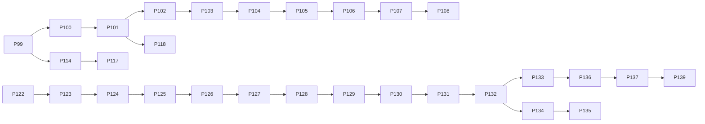

# VARE Flagship Research Sprint II — Results

**Snapshot date:** 2026-10-27 (local, Asia/Tokyo)  
**Repository:** [mitukx/VARE](https://github.com/mitukx/VARE)  
**Research branch / PR:** `codex/development-navigation-campaign-v1`, [draft PR #139](https://github.com/mitukx/VARE/pull/139), initial sprint head `25c16910f47f5f1b1aa84d7325723a1a3ad4dc29`, coding-agent evidence head `3a32eff5aad7a1abef04eb8789b1672d307a2ede`, historical-test correction head `ca1cdea63277e2e2a072d6d90920c09e878a54ab`, fresh model-coupled systems protocol/runner head `5ccee0108c9d27b1b5f003bf479fb533e323b79c` (base branch `codex/navigation-integrity-fixes-v1`, base `6d95bd9196645ec7ecf7ff5d0c9ec997b24dcab1`). A follow-up commit retains the new run outputs and extends the offline auditor; exact-head CI is recorded on PR #139 after that push.
**Main observed at audit start:** `f3ab90a36e8724441b6b9555255f8f75a0a4d529`.

## Executive result

This sprint produced new real-model coding-agent trajectories, a schema-slot tool protocol, a stronger 14B CPU comparison, new qualified external Transformers Development tasks, a concrete public-test false-positive fix, and a fresh-seed real-model GRPO systems replication. It did **not** produce an independently verified coding repair: the coding cohort yielded **0 correct repairs across 7 task families**. Two attempts applied source changes, but both candidates failed the independent grader. The systems replication made 12 genuine optimizer updates to a pretrained model using synthetic checksum rewards and passed independent numeric/state replay; this is systems evidence only, not coding capability or Coding RL evidence.

The most important engineering discovery was that the isolated test runner executed `python test_public.py` directly. On a pytest-style file this defines `test_*` functions and exits successfully without invoking them. A second issue allowed workspaces whose test file differed from the task-pinned test. The runner now invokes zero-argument public tests in its pinned, network-disabled container, fails closed on unsupported fixtures/no-op files, and checks the test-file hash against the task contract. The historical “public pass” records remain intact and are explicitly not credited as test evidence.

## Engineering changes and validation

The #139 branch adds:

- `schema_slots_v1/v2`: model-selected tool names are token-constrained to the declared tool set; argument names and types are taken from each closed JSON schema; the model still generates raw values; invalid values fail closed. The controller serializes only type-valid values and does not repair arbitrary model text. V2 also constrains required terminal newlines for leased source edits.
- `lease_bound_navigation_v2` and versioned navigation guidance for short source search, narrow reads, lease coverage, and raw source output.
- Actual execution of public `test_*` functions in the pinned sandbox; unsupported fixture signatures and test files with no executable assertions are rejected.
- A task-bound SHA-256 for `test_public.py`, checked before inference, plus a finish-time syntax gate for all allowlisted Python files.
- Tests for all supported tool schemas, source navigation, slot constraints, task/test binding, and public runner regressions.

### #139 historical CI failures

The MLX fake-module fixture provides `set_default_device` and verifies device setup before model loading; the previous fixture exposed an incomplete API compared with the real runner. The V5 continuation test creates and runs the immutable historical campaign checkout, while the auditor still validates every pinned path and hash and separately records the current campaign source. No historical hash or accepted source set was changed.

The first updated head, `549cb7e0`, exposed stale live-tree assumptions. All three Python versions failed the same two historical-inventory tests: 3.11 had **1,713 passed, 125 skipped, 3 failed**; 3.12 had **1,724 passed, 115 skipped, 2 failed**; 3.13 had **1,714 passed, 125 skipped, 2 failed**. One test compared the evolving checkout's runtime set with frozen V4; another used current `HEAD` as an “unpinned” fixture despite two new runtime modules. The E2E CPU job exposed a third stale comparison in the model-backed campaign test (**95 passed, 3 failed**): it expected the current checkout to remain exactly 80 files instead of checking the manifest's pinned runtime commit and hashes. The tests now verify immutable historical commits and digests; an unpinned SHA with the same historical 80-file tree remains rejected. Frozen source sets and hash validation are unchanged. The 3.11 run also timed out once in an unrelated slow-step heartbeat test; that test passed when rerun alone locally. The Python logs and full E2E failure log are retained under `results/sprint_ii_20261027/pr-audit/`. The corrected local focused suite, including `tests/test_e2e_rl_continuation.py`, completed with **153 passed, 83 skipped** (the actual-model campaign fixture is skipped locally because no `VARE_E2E_MODEL_DIR` was provided), and the heartbeat test passed separately. The correction was pushed as `ca1cdea6`. Its exact-head checks all passed: Python 3.11/3.12/3.13, lint, typecheck, blob budget, math500, seeded summary, RVL inference, calibrated CPU tasks, and actual optimizer/recovery. See the exact [CI run](https://github.com/mitukx/VARE/actions/runs/40403819460), [CPU-evidence run](https://github.com/mitukx/VARE/actions/runs/40403819485), and [E2E system run](https://github.com/mitukx/VARE/actions/runs/40403819458).

The original #139 head `25c16910...` had 20/20 successful check records. At `549cb7e0`, seven check types succeeded and the Python matrix plus E2E system job failed for the stale comparisons above. The correction at `ca1cdea6` passed all 11 check types, including the model-backed E2E continuation/recovery suite. The subsequent protocol/runner head `5ccee010...` had its source checks green while the matrix/optimizer jobs were still in progress at the last snapshot; exact-head checks for the follow-up evidence commit are recorded on PR #139. On the separate [#120](https://github.com/mitukx/VARE/pull/120) correction head `609c5f302f538e6780480b80fc9fb2031273737a`, all 11 CI checks also succeeded. #120 remains blocked by required human review and unresolved review threads.

The selected local suite completed with **124 passed, 14 skipped** before the final historical-test correction; the expanded suite with `tests/test_e2e_rl_continuation.py` then completed with **153 passed, 83 skipped**. `ruff check` and `git diff --check` passed before the final report-only commit. No merge was performed.

On the separate #120 worktree, its changed-file suite completed with **8 passed** and lint/compile/diff checks passed. A broader related suite completed with **73 passed, 4 skipped, 3 failed**. The three failures are in untouched `tests/test_separated_candidate_harness.py` oracle controls; the retained rerun shows `correctness_failed`/`malformed_result`. Their cause was not established, so they are not hidden or attributed to the #120 patch. See `results/sprint_ii_20261027/pr-audit/pr120-local-regression-failures.txt` and the new exact-head CI for the authoritative follow-up.

### Public-test runner regression

The corrected runner was exercised against task-pinned baseline, known-fix, incorrect-mutant, and candidate inputs where the saved validation protocol provides them. In the DataCollator case, the corrected controls report baseline **FAIL**, known fix **PASS**, mutant **FAIL**, and model candidate **FAIL**. The candidate also fails its independent grader with `unexpected indent` at line 621. Its earlier recorded public pass is invalidated by the runner defect and a workspace/test hash mismatch; the original artifact is retained without rewriting. In the video task, the old “pass” exercised a weak module-level assertion that checked syntax/function presence, not the semantic repair; the independent grader reports `minimum_fps_count_not_enforced`.

## Model and frozen experimental setup

### Hardware and software

- Apple MacBook Pro, M1 Pro, 32 GB unified memory; macOS 27.0.1 arm64.
- Python 3.12.12; MLX 0.32.4; mlx-lm 0.32.2.
- Local CPU MLX inference for the principal 7B and 14B coding arms. No paid API or cloud inference; no model weights were downloaded for this campaign.
- Isolated public-test image: `python@sha256:34386ef0cb081344d7ec1c103ba398e6e9f64e9ab3a1509accc92a4e24a07258`.

### Checkpoints and tokenizer identities

| Arm | Checkpoint | Snapshot | Quantization / backend | Template identity |
|---|---|---|---|---|
| Main and template comparison | `mlx-community/Qwen2.5-Coder-7B-Instruct-4bit` | `019cc73c45c770444708a6dd8690c66243cc5c80` | 4-bit, MLX-LM CPU | Original cached tokenizer config SHA-256 `f7c61e32b7a17d19bf8e7037dcb74079a833e53ea9801f24008cac68458f03b7`; isolated template-only override SHA-256 `7e88129d9769a0b14b1587a7d5e829fe93ac0e1511636471fdfc0811951418e6`. The override changes only `chat_template`; the cached snapshot was not modified. |
| Stronger comparison | `mlx-community/Qwen2.5-Coder-14B-Instruct-4bit` | `29efdbab55a161237ab1e432a3abaf6c7ae2b477` | 4-bit, MLX CPU | Snapshot-native corrected Qwen2.5 template; tokenizer config SHA-256 `7e88129d9769a0b14b1587a7d5e829fe93ac0e1511636471fdfc0811951418e6`; effective template SHA-256 `cd8e9439f0570856fd70470bf8889ebd8b5d1107207f67a5efb46e342330527f`. |

The 14B weights are identified in each protocol by both safetensor shard hashes. The complete per-file checkpoint, tokenizer, rendered-prompt, controller, task, grader, and trajectory hashes are retained with the run artifacts. Upstream public source may have been present in pretraining; this study makes no novelty claim about model exposure.

### Protocol and controls

The preregistered first cohort paired the same 7B snapshot, source task, strict raw parser, tool interface, and per-arm budget across (A) cached original template, (B) isolated corrected template, and (C) corrected template with schema-slot generation. Each arm had one attempt on the CSM task, so this is a **feasibility comparison with N=1 per arm**, not an efficacy estimate. Subsequent controller variants were run prospectively on separate task packs or unused task instances. They are diagnostic observations, not independent samples for a model-comparison claim.

The 14B task protocols used seed 73 where specified, up to 20 turns, up to 8,192 generated tokens total, 1,024 tokens per turn, 8,192 context tokens, 12,288 MiB process-tree RSS, and a 3,600-second cap for CPU long runs. The source-only edit instruction was a single versioned, task-independent intervention, applied only to the replace-text slot and tested on a new task. Resource preflights required at least 700 MiB free swap and at least 70% free memory. Prospective CPU arms capped swap growth at 512 MiB; an earlier 14B arm retained its pre-existing 768 MiB cap. No cap was raised during this campaign.

## External Development task qualification

Seven Development task families were assembled from public Transformers fixes; MusicGen and MusicGen Melody are two source-specific variants of the same cached-position family. The eight task packs record upstream source revisions, base source identities, known-fix identities where available, candidate-visible files, separate grader artifacts, and public tests. The saved controls establish baseline failure, known-fix success, and incorrect-mutant failure for these tasks. Some graders are source/AST contracts or constrained behavioral probes, not full upstream test suites; this limits the strength of the benchmark. Tasks were selected after prior VARE model attempts and none are reserved held-out tasks. Public availability means pretraining exposure cannot be excluded.

| Family / task | Upstream identity | Qualification / grader character |
|---|---|---|
| CSM codebook embedding tying | Transformers PR [#49197](https://github.com/huggingface/transformers/pull/49197); upstream source `50e35cc0ca18ec19b80653690de553e6decf74f5`, local base `f64044270ba3cb6d006a9ca18e944a7609726ea6` | Baseline fail, known fix pass, mutant fail; separate configuration contract grader. |
| Video short-FPS minimum frame | Transformers PR [#49908](https://github.com/huggingface/transformers/pull/49908); upstream source `1a55addd658aaa95b52871f5b72e91a6b91449b6`, local base `b36173c2ccd7834b77c3541854a50e2ad67a9f8f` | Baseline fail, known fix pass, mutant fail; bounded arithmetic probe and independent source contract. |
| MusicGen cached positions | Transformers PR [#49842](https://github.com/huggingface/transformers/pull/49842); upstream source `f348d3dcfa9317bed603e01b8ca22b11fe59615c`, local base `d810cee130801c93a3dc066e648f99de8f25f86d` | Baseline fail, known fix pass, mutant fail; independent cached-length contract. |
| MusicGen Melody cached positions | Same upstream fix/family as #49842; local base `bee525abbbb1370deaf45a24bd5a1650ca66ab3e` | Baseline fail, known fix pass, mutant fail; sibling implementation, not an independent family. |
| Kernel config MPS support | Transformers PR [#49655](https://github.com/huggingface/transformers/pull/49655); upstream source `1573af48b1c5cd8bfb0cfba4dc1ecf6e882d0348`, fix `be67386f98c22ca61e446c715a8e758b0b7fa4e0` | Baseline fail, known fix pass, mutant fail; independent contract plus public test. This model run had a workspace/public-test identity mismatch and is not a valid public-test outcome. |
| DataCollator seed zero | Transformers PR [#49349](https://github.com/huggingface/transformers/pull/49349); upstream source `5a27d2d2706cbd1ee36d1a8e8441656bb88e7f04`, fix `b4526a7658b216e6674f776cf7eac84b346fcd32` | Baseline fail, known fix pass, mutant fail; independent source contract and corrected public-runner controls. |
| SuperPoint comprehension shadow | Transformers PR [#49409](https://github.com/huggingface/transformers/pull/49409); upstream source `ea9259355388f518240f96a8c2dee7311b1c5911`, fix `f2ae8da4d3ea45e1138862af42ac25da6d3e7e89` | Baseline fail, known fix pass, mutant fail; source-binding grader and public test. |
| `move_to_device` mapping type | Transformers PR [#49731](https://github.com/huggingface/transformers/pull/49731); upstream base `01269bc99768ad45f8aeaeb701e1315371e25239`, fix `b19c4a6669eab3d446789405d5bd00c3ace65863` | Baseline fail, known fix pass, mutant fail under control protocol v2; independently graded isolated behavioral probe with tensor stub and public test. |

The task-level protocol and controls are under `results/sprint_ii_20261027/external_coding_dev/`. These are Development tasks for controller and agent evaluation. No reserved held-out task was read, changed, or used.

## Real-model trajectories and grading

The primary external cohort contains **12 inference attempts across 7 task families** (including the paired template arms and controller variants), plus one recorded SuperPoint launch error that did not enter inference. Every completed trajectory retains model output, token counts, tool decisions/results, rendered prompt hashes, resource samples, candidate source hashes, and separate grader output. All runs were resource-complete; none aborted at an RSS, swap, or wall limit.

| Task / model | Attempts and observed behavior | Independent result |
|---|---|---|
| CSM; 7B corrected-template comparison | Original-template raw and corrected-template raw each ran 4 turns (~24 s, 170/166 generated tokens); neither produced an accepted action. Corrected-template schema-slot arm reached 10 turns (~488 s, 81 tokens) and exhausted context before editing. | No patch; no repair. The one-per-arm raw comparison shows template correction alone did not fix the tool boundary. |
| Video short-FPS; 7B | One 20-turn run, 782 tokens, ~689 s. It searched/read and attempted navigation but did not apply a repair. A weak public smoke assertion reported pass; the independent grader rejected the unchanged candidate (`minimum_fps_count_not_enforced`). | Fail. The smoke pass is not semantic evidence. |
| MusicGen cached positions; 7B | Two 20-turn runs (~462 s/231 tokens and ~698 s/408 tokens). One never attempted an edit; the navigation-v2 run proposed an edit but the lease/policy rejected it. | Both independent grades fail with `cached_length_growth_condition_missing`. |
| MusicGen Melody cached positions; 7B | Two 20-turn runs (~443 s/267 tokens and ~745 s/268 tokens); repeated source navigation, no edit. | Both fail with `cached_length_growth_condition_missing`. |
| Kernel config MPS; 14B | Three model turns, 525 tokens, ~158 s. It failed strict action parsing before editing. Swap grew 640 MiB under that arm's pre-existing 768 MiB cap; no resource abort. The workspace public test hash did not match the task-pinned test. | No candidate repair; public outcome is boundary-invalid. The task's independent baseline/fix/mutant controls passed qualification. |
| DataCollator seed zero; 7B | Five turns, 184 tokens, ~125 s. It applied one malformed edit; the old runner falsely reported public test passes. Peak sampled RSS ~4.36 GiB, swap growth 0 MiB. | Independent grader fails (`source_parse_failure`, unexpected indent line 621). Corrected runner controls show candidate fail. |
| SuperPoint compile shadow; 14B CPU | First launch was missing the required `--instruction` and produced no inference. The amended attempt completed 3 tool turns, 1,042 tokens, ~196 s, then exhausted an argument-value slot on explanatory output. Peak RSS ~8.20 GiB; swap growth 0 MiB. | No edit; independent grader confirms baseline failure (`compiled_forward_binding_incomplete`). |
| `move_to_device` mapping type; 14B CPU + source-only text-slot guidance | One 20-turn run, 640 tokens, ~1,431 s. It applied three edits, but emitted Markdown-fenced/full-function text into a narrow leased replacement. Public tests failed with syntax error; it exhausted the turn budget. Peak RSS ~8.23 GiB, swap growth -16 MiB, no resource abort. | Independent grader fails on candidate syntax (`grader_execution_failure`, SyntaxError line 210). This is the strongest completed edit trajectory, but not a correct repair. |

Across the seven family-level task units the primary metric is **0 independently verified repairs / 7 task families**. Attempts are clustered by task and controller, not independent Bernoulli observations. A small-sample interval would imply unjustified generalization, so results are descriptive; no broad capability delta or model ranking is claimed. Invalid, aborted, and ungraded attempts are not counted as completions. The kernel arm is excluded from any public-test success calculation; no attempt is counted as a repair.

### Schema-constrained action generation

Static contract tests cover all exposed actions (`list_files`, `search_source`, `read_lines`, `replace_lines`, `run_public_tests`, and `finish`) and closed argument schemas. Actual 14B schema-slot trajectories on the synthetic retry fixture repeatedly generated valid tool names and type-valid arguments, and reached search, read, edit, test, and later search actions. The model's leased replacement text repeatedly failed the final-newline/range policy; public assertions remained failing and the bounded run did not finish successfully. On external Development work, schema slots enabled actual searches, reads, and applied edit attempts, but did not yield a correct patch. Therefore the protocol is **PARTIAL**: it moves generation past unsupported tool keys, but useful task completion is not established.

The source-only edit intervention was tested prospectively on the unused `move_to_device` task. It reduced verbosity enough for the model to apply edits, but did not make the generated source syntactically valid. This is one hypothesis-driven intervention, not a tuned success claim.

## Learning, held-out, long-horizon, and RSI gates

- **Coding-reward SFT / GRPO:** not run. No independently correct coding trajectory or eligible nonconstant coding-reward group was available. The separate systems-only run below uses synthetic checksum rewards and is not Coding RL evidence.
- **Held-out improvement:** not run. The experiment used Development tasks only and did not satisfy VARE's held-out eligibility gate; no reserved task was used.
- **Model-coupled asynchronous systems:** a new three-seed real-model run completed with synthetic checksum rewards; see below. It does not establish semantic task success or capability improvement and does not repeat the 504-round synthetic control.
- **RSI research automation:** not run. No valid model-proposed code change completed an independently measured benchmark loop.

### Fresh-seed model-coupled systems replication

This was preregistered before inference under protocol `vare.streamed-grpo-systems.sprint-ii.v1`, SHA-256 `8507aede0b57ea08e75ae1d758df78b813adf637d0ee52bbe2554e9c5007cbe5`, at `results/sprint_ii_20261027/streamed_grpo_v32/protocol.json`. It uses fresh seeds 82014, 82015, and 82016, four rounds per seed, group size four, two-step tool-observation/model-generation trajectories, a single declared lost-acknowledgment fault, and 131,200 trainable parameters. The pretrained checkpoint is `roneneldan/TinyStories-1M` at immutable revision `77f1b168e219585646439073245fe87e56b3023e`; all model file hashes are pinned in the protocol. The learner ran PyTorch 2.9.1 / Transformers 4.57.3 on CPU fp32 with one Torch thread, two execute workers, and one verifier. The protocol predeclared VARE source revision `3a32eff5aad7a1abef04eb8789b1672d307a2ede`; inference ran at `5ccee0108c9d27b1b5f003bf479fb533e323b79c`, which adds only the frozen protocol and runner (no `src/vare` or reference-script changes). Each execution archives and audits all source-file hashes against this frozen source content. Runner SHA-256 is `719e6382df27bbe36991460b51db88822b8d26326865cddf6369d8542aecfa22`.

All **3/3 seeds** completed 4/4 optimizer updates. Across the campaign the runner admitted 48 trajectory completions, consumed 36, quarantined the 12 uncertain deliveries, and recorded **zero duplicate effective updates**. The declared rejection occurred on each seed. Each lost acknowledgment was retained as unresolved, recovery loaded the exact model/optimizer/RNG state, and the next update used that recovered policy. The fault simulation is a **same-process logical restart**, not learner SIGKILL or machine failure.

An independent offline auditor replayed all 12 updates and verified full-graph/preclip gradients, clipped gradients, parameter tensors, losses, Adam state, behavior alignment, RNG state, archived source and model bytes, and the trajectory-store ledger. All 12 replay checks passed; the auditor also passed again after each seed's checkpoint archive was restored, verifying the external archive procedure. Worst absolute errors were `4.77e-7` (preclip gradient), `2.98e-8` (clipped gradient), `7.45e-9` (parameters), `1.49e-8` (loss), `3.73e-9` (Adam state), and `2.48e-5` (behavior alignment). Each seed took 6.33–7.10 s of runner wall time; maximum RSS was 862.85 MiB. Host swap used/free remained 1251.31/796.69 MiB, with measured growth 0 MiB, inside the predeclared 700 MiB minimum-free and 512 MiB growth limits.

The task reward is a synthetic SHA-256 checksum and the independent diagnostic score is another checksum. These rewards make controlled model updates possible but encode no coding correctness or useful language objective. This run therefore provides **narrow model-coupled verifier-aware ingestion, update, checkpoint, logical-recovery, and numerical-replay evidence**. It does not compare synchronous against asynchronous throughput, measure semantic capability, or qualify a coding-training dataset. `aggregate.json` summarizes the run. Raw outputs, journals, source snapshots, and independent audit results remain under the v3.2 result directory. The nine checkpoint/gradient blobs per seed are stored outside Git in hash-verified tar.zst archives; `external-checkpoint-archives.json` records archive digests and restore paths. Restore with `zstd -dc <archive> | tar -xf - -C <seed-output>` before repeating the offline audit. The model's ~29 MB base checkpoint is separately identified by the pinned model hashes.

The first audit attempts were rejected because the invocation placed the external anchor inside the artifact, then because the offline auditor knew frozen protocols only through v3.1. Repeating the audit also exposed that Python-generated `__pycache__` files made the source inventory appear incomplete; the auditor now ignores interpreter bytecode while requiring exact hashes and complete coverage for every substantive source file. These failures are retained as logs and the repeated audit passes on all three restored archives. The auditor registers v3.2 as an exact protocol byte-for-byte match and selects its distinct archived runner path; it continues to reject unknown or modified protocol data. These changes fix audit repeatability/version dispatch without changing the frozen protocol or weakening artifact hash validation.

## PR consolidation and engineering audit

The initial live audit found 33 open PRs. Eighteen evidence-only or superseded PRs were closed while retaining their branches and repository artifacts; no commits or unique results were deleted. These were `#88, #100–#107, #123–#125, #127–#130, #132, #134`. PR #103 was closed as superseded; the other closures were evidence archives. No PR was merged.

| Live PR measure | Before | After captured sweep |
|---|---:|---:|
| Open PRs | 33 | 15 |
| Closed during sprint | 0 | 18 |
| Merged during sprint | 0 | 0 |
| Existing open PRs updated | 0 | 3 (`#120`, `#133`, `#139`) |
| Draft PRs | 18 | 8 |
| PRs with `REVIEW_REQUIRED` | 5 | 4 (`#99`, `#120`, `#121`, `#122`) |
| Unresolved review threads | 17 | 10 |

The after snapshot is timestamped in `results/sprint_ii_20261027/pr-audit/pr-ledger-after.json`; PR check states and exact heads are also captured in `pr-checks-live-final.json`. The after counts reflect actual GitHub state, not recommendations. The snapshot records #139 at `ca1cdea6`, with CI successful, Draft status retained, and its dependency on still-open #137.

The machine-readable ledger contains the full per-PR dependency relation. The active stacked lines reduce to:



The graph describes branch ancestry, not merge eligibility. Many intermediate nodes were closed while preserving commits and evidence; the ledger records each disposition and whether its recorded base SHA still matched.

The #139 branch was updated with the controller/test-runner fixes, focused regression tests, full new campaign artifacts, and this report. Two unresolved P2 review threads on [#133](https://github.com/mitukx/VARE/pull/133) received evidence-based replies linking to the descendant corrections on #139; the threads are still unresolved on #133 itself. The exact reply links and machine-readable snapshots are in `results/sprint_ii_20261027/pr-audit/`.

The two P1 findings on [#120](https://github.com/mitukx/VARE/pull/120) were also addressed on the existing branch, now at `609c5f30`. The #1910 candidate grader rejects task-incompatible process-control imports, dynamic execution, output, and early-exit APIs before candidate execution; an adversarial import/print/`os._exit(0)` test asserts that neither source archival nor Docker execution begins. The evidence verifier now rejects absent and empty inventories. The focused suite passed **8 tests**, Ruff/compileall/diff checks passed, and both review threads received regression-evidence replies. These are task-scoped safeguards, not a general proof that arbitrary candidate code is safe; keep #120 out of an active reward path until exact-head CI and human review pass. The review threads remain open.

An exact per-PR ledger with before/after heads, base SHAs, draft and CI state, unresolved review findings, dependencies, changed-path inventory, and one primary disposition for every original PR is retained at `results/sprint_ii_20261027/pr-audit/pr-ledger-after.json`. The original audit snapshot is preserved separately. At the initial post-closure snapshot, the remaining 15 open PRs were `#99, #108, #114, #117, #118, #120–#122, #126, #131, #133, #135–#137, #139`; eight were drafts. No green CI is treated as a merge approval.

### Remaining critical integration blockers

- [#120](https://github.com/mitukx/VARE/pull/120): the two P1 code findings have a pushed task-scoped correction at `609c5f30`, regression tests, and **11/11 successful exact-head CI checks**. Both review threads remain unresolved, so keep it out of the active reward path until reviewer acceptance.
- [#133](https://github.com/mitukx/VARE/pull/133): two P2 findings on source-search output bounding and transient index-rebuild recovery; fixes are present in the #139 descendant, but #133 itself remains unresolved.
- [#117](https://github.com/mitukx/VARE/pull/117): unresolved P1/P2 findings in the MLX-LM source isolation lineage.
- [#99](https://github.com/mitukx/VARE/pull/99): two unresolved P1 findings in the historical Development evaluator/source-integrity path.
- #139 remains Draft and stacked on #137. Its `ca1cdea6` code-correction head passed all 11 exact-head check types; the later protocol, runner, and report commits require their own exact-head CI and normal review before integration.

## Outcome table

| Area | Status | Decision |
|---|---|---|
| Schema-constrained tool generation | **PARTIAL** | Static schemas pass; real-model tool actions progress, but no successful bounded repair. |
| Corrected-template inference | **RUN** | Template override reaches real Qwen2.5 generation; template-only arm did not fix raw tool invocation. |
| Strong-model inference | **RUN** | Cached Qwen2.5-Coder-14B 4-bit on MLX CPU completed long trajectories within resource caps. |
| External Coding Agent tasks | **RUN** | 7 families / 8 task packs qualified and evaluated on Development. |
| Independently verified repairs | **NO-GO** | 0 / 7 task families; applied edits were syntactically/semantically invalid. |
| Coding-reward SFT / GRPO | **NOT_RUN** | No eligible positive coding examples or coding-reward variation. |
| Held-out improvement | **NOT_RUN** | Development-only and eligibility gate unmet. |
| Real model optimizer updates | **RUN** | 12 model-coupled GRPO updates over 3 fresh seeds on TinyStories-1M; checksum rewards only. |
| Model-coupled asynchronous systems | **PARTIAL** | Independent numerical/recovery replay passed on all 12 updates; no sync/async throughput comparison, process-kill fault, or semantic reward. |
| Coding RL improvement | **NO-GO** | No verified coding repair or eligible coding-reward data. |
| RSI research automation | **NOT_RUN** | No successful agent-proposed benchmark change. |
| PR closures | **RUN** | 18 evidence-preserving closures; open count fell from 33 to 15 at the captured snapshot. |
| PR merges | **NOT_RUN** | 0; review/dependency gates remain. |
| Remaining blockers | **PARTIAL** | #120 review/CI, #133 P2 navigation, #117/#99 findings, and stacked review on #139. |

## Reproduction and evidence layout

From the VARE repository root, the focused regression suite is:

```bash
PYTEST_DISABLE_PLUGIN_AUTOLOAD=1 python -m pytest -o addopts='' -q \
  tests/test_run_local_agent_tool_format.py \
  tests/test_source_navigation_v1.py \
  tests/test_schema_slot_protocol.py \
  tests/test_source_navigation_v2.py \
  tests/test_navigation_guidance_v2.py \
  tests/test_separated_grading.py \
  tests/test_mlsys_coding_v2_candidate_grader_v1.py \
  tests/test_mlsys_coding_v2_candidate_grader_v2.py \
  tests/test_coding_agent_workspace_binding.py \
  tests/test_corrected_template_campaign_v1.py
```

Raw coding-agent outputs, append-only event journals, prompts and hashes, task packs, frozen protocols, candidate diffs, grader outputs, resource samples, and verified baseline worktree bundles are under `results/sprint_ii_20261027/`. The v3.2 model-coupled systems artifact includes per-seed model/update/trajectory metadata and independent audit outputs; exact checkpoint and gradient files are retained in the external hash-verified archives listed by `streamed_grpo_v32/external-checkpoint-archives.json` because the repository's frozen blob census disallows adding >1 MiB blobs. `evidence-manifest.json` records SHA-256 and byte size for repository-retained files other than itself. The Git bundles retain candidate baseline histories that were formerly nested worktrees; their own hashes and `git bundle verify` output are in `baseline-bundle-manifest.json`. No model weights are stored in Git.

## Next highest-value experiment

Keep the 14B CPU protocol and task-independent source-only instruction fixed. Before consuming another external task, add a versioned edit affordance for a narrow leased source range that asks the model for only raw replacement lines and explicitly distinguishes literal newlines from `\\n`; validate it with a real-model synthetic interaction, then preregister a new Transformers Development task whose independently certified repair is a small local hunk. Continue to require exact public-test binding and independent grading. The objective is one clean positive repair, not more parser-only runs. Only after that should the team consider collecting reward-eligible Train trajectories or designing a held-out evaluation.
